# ELEC 3 - Node.js Programming

## Student Information

- **Full Name:** MARY ROSE A. PURUGGANAN
- **Section:** IV-BSIT C
- **Course:** ELEC 3 - Node.js Programming
- **Submission:** Set 1

## Project Overview

This repository contains my self-paced learning activities for ELEC 3. These activities demonstrate Node.js package management, custom modules, mathematical operations, file handling, and error handling.

## Set 1 Activities

| Activity | Description | Folder |
|---|---|---|
| N1 | Project Setup and Package Management | [View N1](set1/n1-setup) |
| N2 | Modular Calculator | [View N2](set1/n2-calculator) |
| N3 | File Manager with fs and path | [View N3](set1/n3-file-manager) |

---

## N1 - Project Setup and Package Management

This activity demonstrates npm initialization, package installation, dependencies, development dependencies, and npm scripts.

### How to Run

From the repository root:

```powershell
cd set1/n1-setup
npm install
npm start
```

### Screenshots

**Version Check**

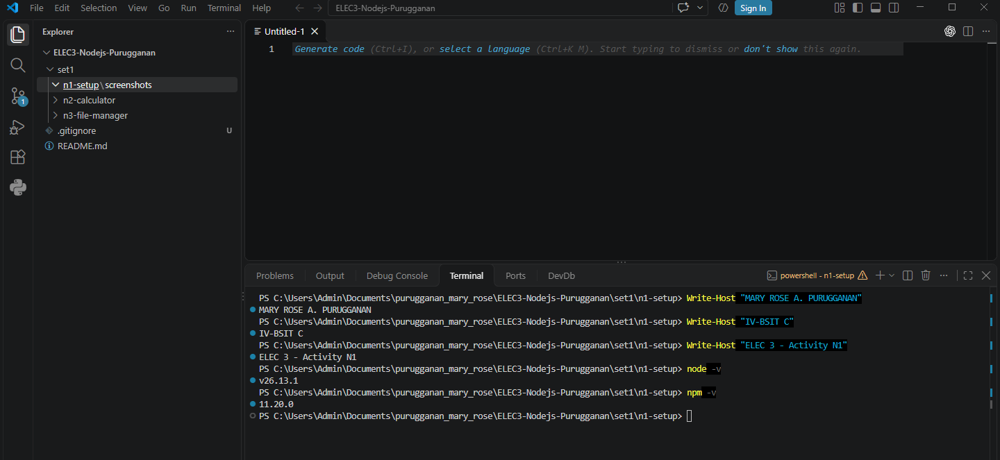

**Package Configuration**

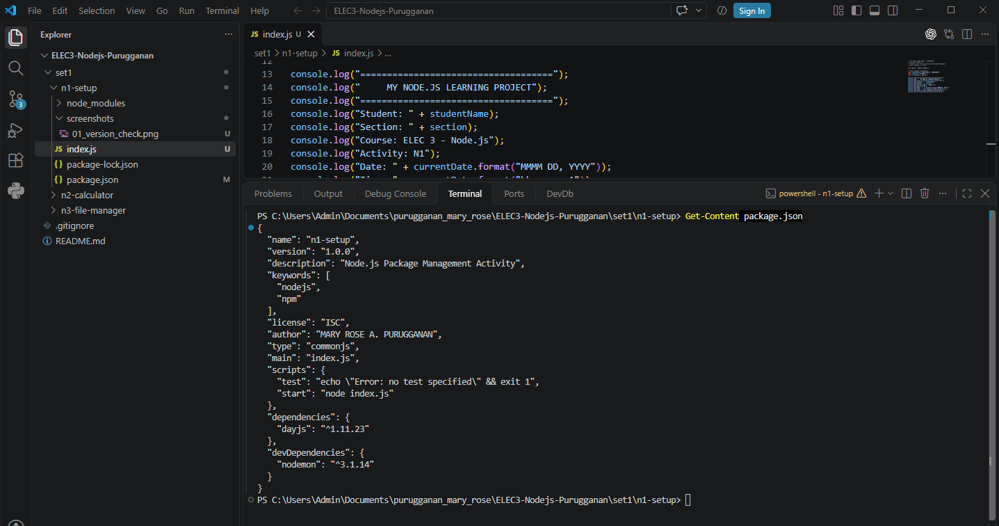

**Program Output**

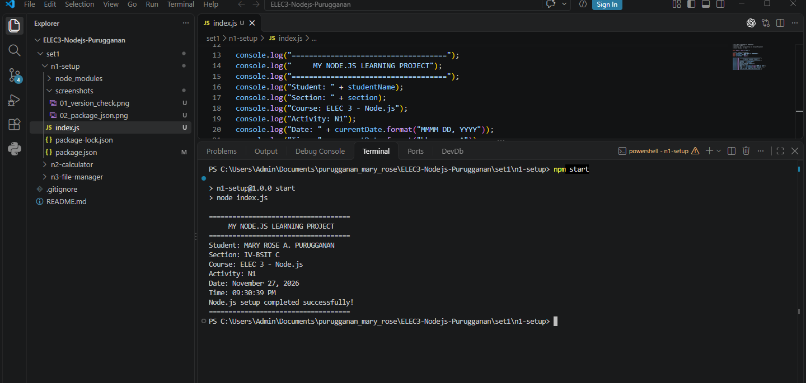

### Written Answers

[View N1 Answers](set1/n1-setup/N1_answers.docx)

---

## N2 - Modular Calculator

This activity demonstrates custom modules, built-in modules, command-line arguments, mathematical functions, and error handling.

### How to Run

From the repository root:

```powershell
node set1/n2-calculator/index.js add 20 5
node set1/n2-calculator/index.js subtract 20 5
node set1/n2-calculator/index.js multiply 20 5
node set1/n2-calculator/index.js divide 20 5
node set1/n2-calculator/index.js average 20 5
```

### Error Handling Tests

```powershell
node set1/n2-calculator/index.js divide 20 0
node set1/n2-calculator/index.js square 20 5
```

### Screenshots

**Addition**

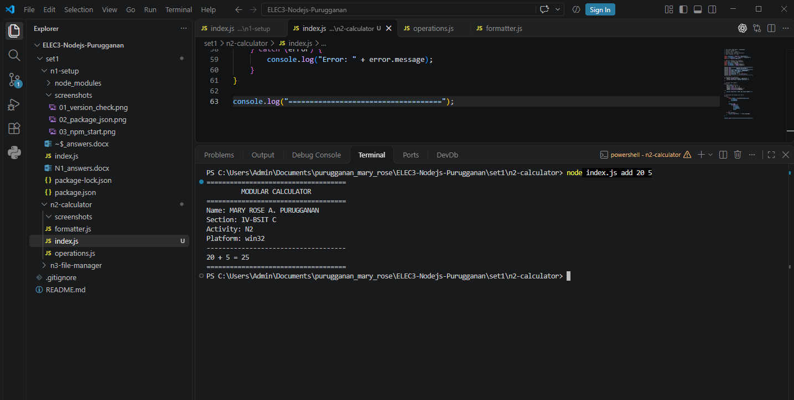

**Subtraction**

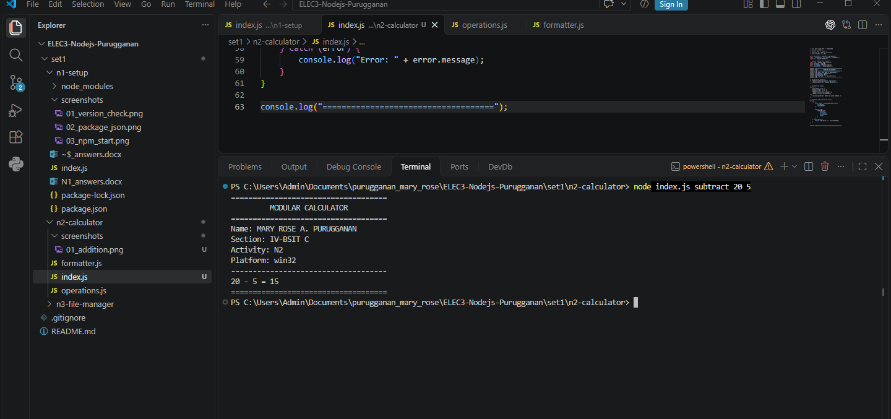

**Multiplication**

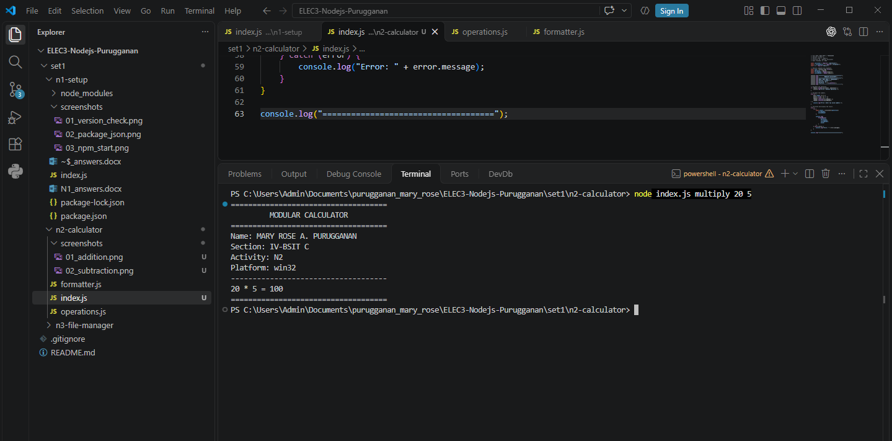

**Division**

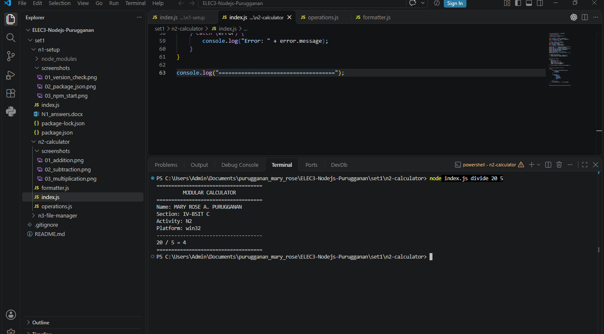

**Average**

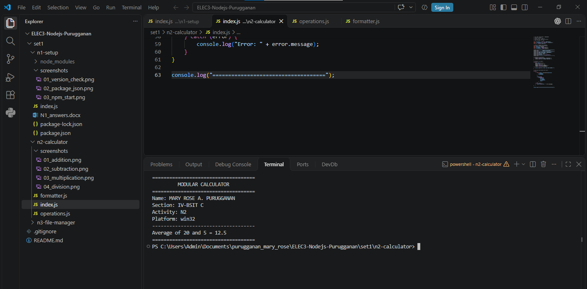

**Division by Zero**

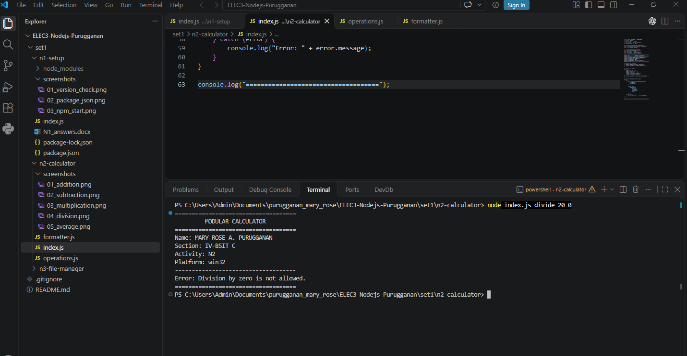

**Unknown Operation**


---

## N3 - File Manager with fs and path

This activity demonstrates file creation, reading, updating, deletion, listing, and error handling using the built-in fs and path modules.

### How to Run

From the repository root:

```powershell
node set1/n3-file-manager/index.js create demo.txt "Hello Node.js"
node set1/n3-file-manager/index.js read demo.txt
node set1/n3-file-manager/index.js update demo.txt "Learning file management"
node set1/n3-file-manager/index.js list
node set1/n3-file-manager/index.js delete demo.txt
```

### Screenshots

**Create Files**

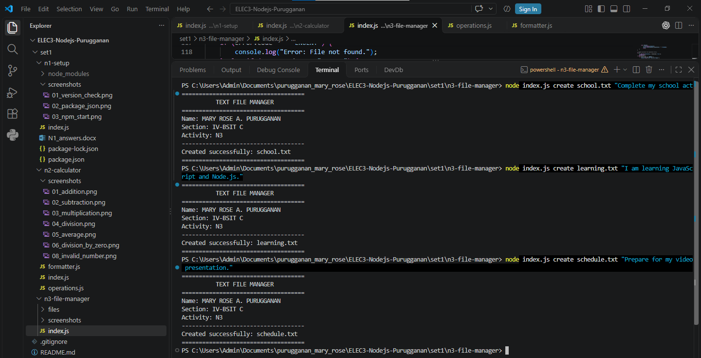

**Read File**

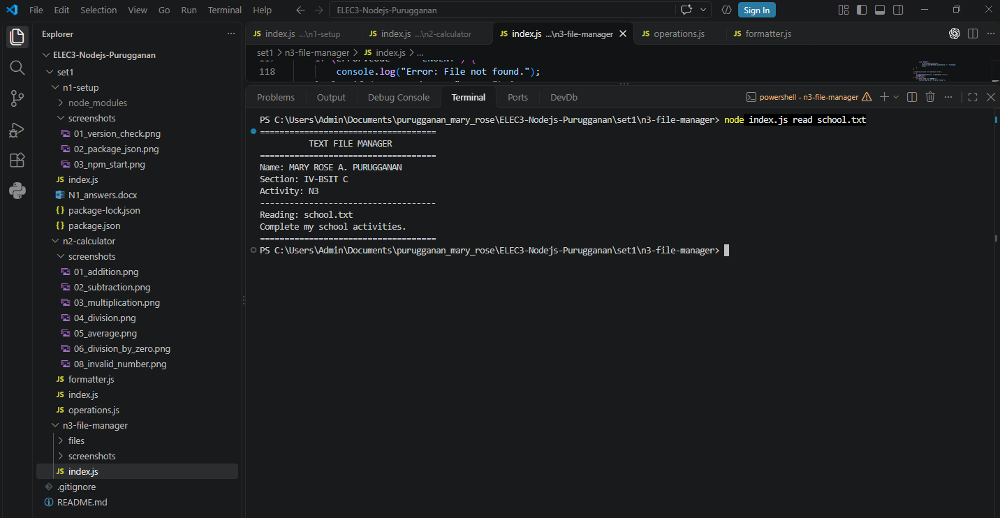

**Update File**

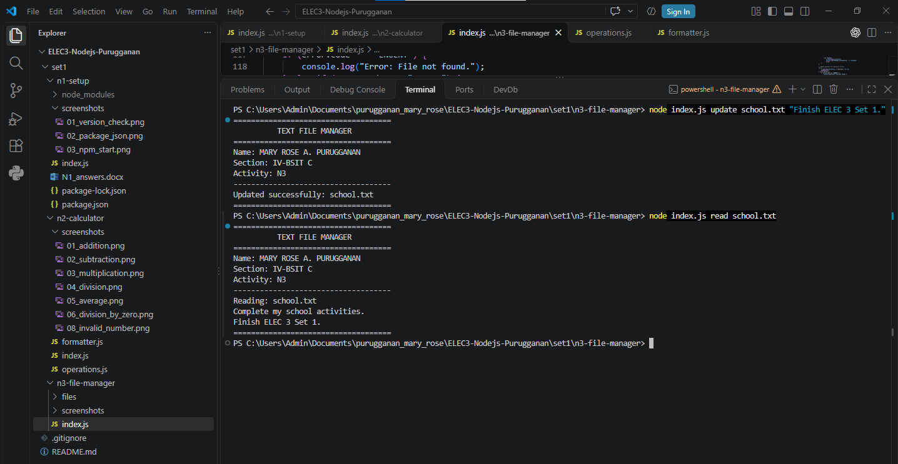

**Delete File**

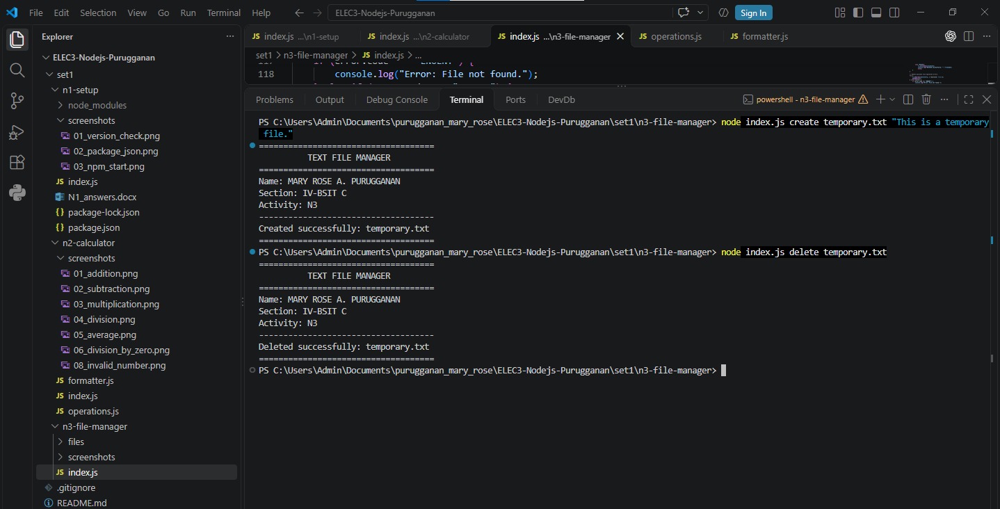

**List Files**

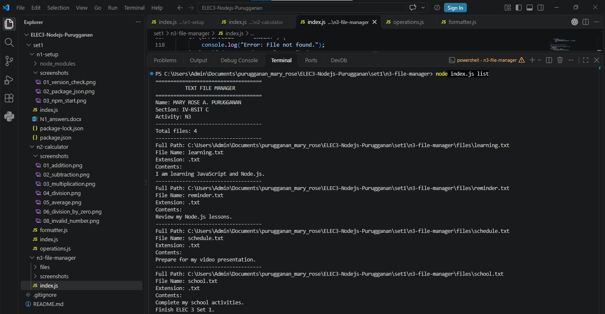

**Read Missing File**

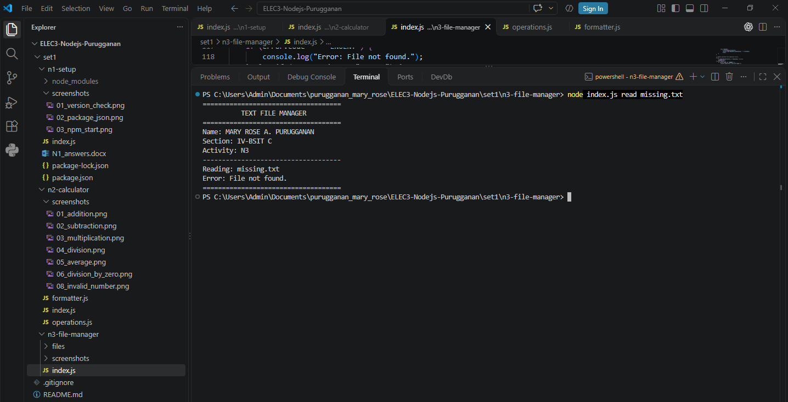

**Delete Missing File**

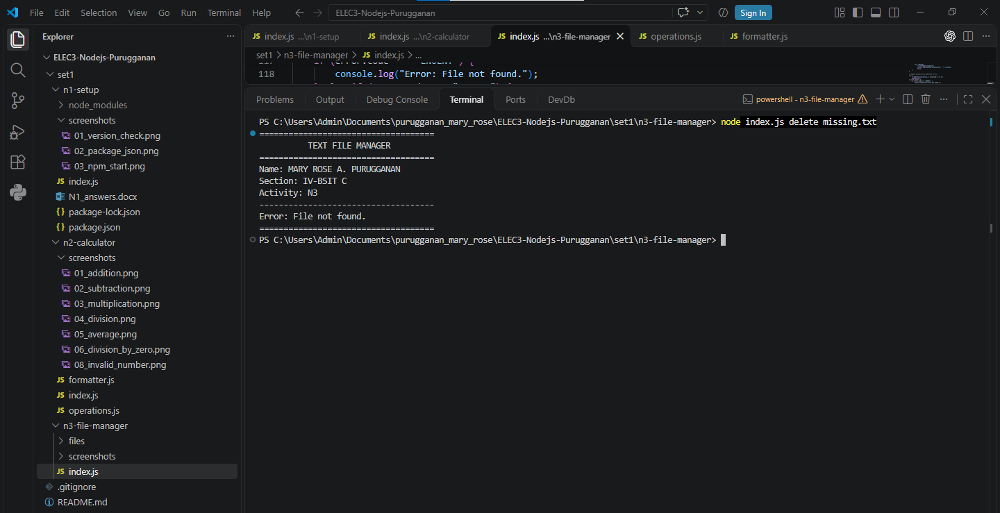

---

## Technologies Used

- Node.js
- JavaScript
- npm
- Day.js
- Nodemon
- Visual Studio Code
- Git and GitHub

## Learning References

- [Node.js Crash Course - Traversy Media](https://www.youtube.com/watch?v=32M1al-Y6Ag)
- [Node.js Documentation](https://nodejs.org/docs/latest/api/)

## Author

MARY ROSE A. PURUGGANAN

IV-BSIT C
